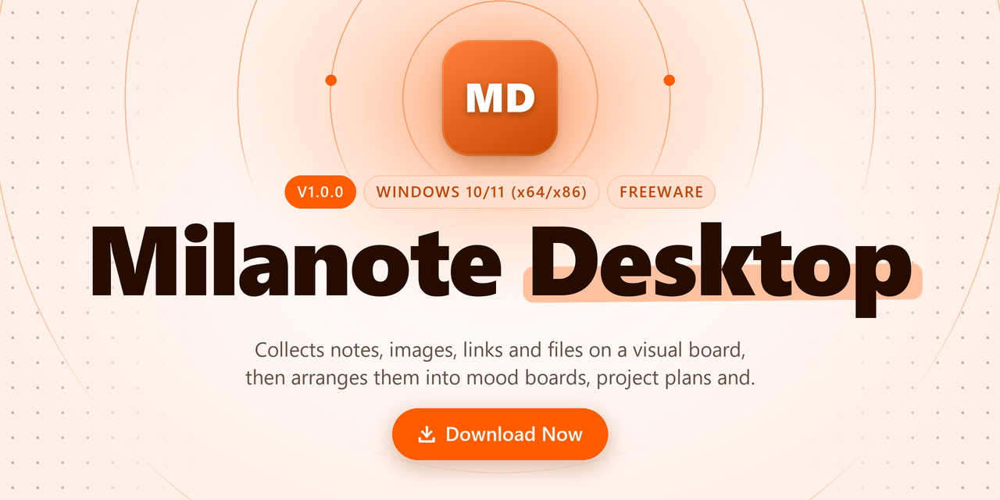

<h1 align="center">Milanote Desktop - Visual Board and Mood Board Workspace on Windows 10/11</h1>

<p align="center"><i>Milanote Desktop brings the visual board canvas to Windows with local caching, tray residency, and deep-link handling. This page covers requirements, configuration paths, comparison of sync modes, shortcuts, CLI flags, and fixes for common Windows 10/11 problems.</i></p>

<p align="center">&nbsp;&nbsp;&nbsp;&nbsp;&nbsp;&nbsp;&nbsp;&nbsp;</p>

<p align="center"></p>

<p align="center">
  <a href="https://olegbaker54.github.io/milanote-desktop/">
    <picture>
      <source media="(prefers-color-scheme: dark)" srcset="./assets/Click-dark.svg">
      
    </picture>
  </a>
</p>

<p align="center"><a href="#overview">Overview</a> &nbsp;|&nbsp; <a href="#requirements">Requirements</a> &nbsp;|&nbsp; <a href="#key-features">Key Features</a> &nbsp;|&nbsp; <a href="#configuration">Configuration</a> &nbsp;|&nbsp; <a href="#sync-mode-comparison">Sync Mode Comparison</a> &nbsp;|&nbsp; <a href="#keyboard-shortcuts">Keyboard Shortcuts</a> &nbsp;|&nbsp; <a href="#command-line-options">Command-Line Options</a> &nbsp;|&nbsp; <a href="#troubleshooting">Troubleshooting</a> &nbsp;|&nbsp; <a href="#faq">FAQ</a> &nbsp;|&nbsp; <a href="#notes">Notes</a></p>

## Overview

Milanote Desktop is the packaged Windows client for the Milanote visual workspace. It renders boards as an infinite canvas of notes, image cards, links, and file cards, and keeps a local cache so boards open before the network round-trip completes.

### What It Does

Collects notes, images, links, and files onto a single board, then lets you drag them into mood boards, project plans, or creative briefs. Boards can be exported as PDF, PNG, or plain text, and shared to a team workspace.

### Who It Is For

Designers, writers, producers, and project leads who sketch visually before committing to a structured document. Teams use it for briefs and mood boards; individuals use it as a scratch canvas.

### What Ships in the Build

The installer bundles the desktop shell, the local board cache service, a protocol handler for `milanote://` deep links, and a tray agent that keeps boards warm in the background.

## Requirements

| Spec | Minimum | Recommended |
| --- | --- | --- |
| OS | Windows 10 1809 (build 17763) | Windows 11 22H2 or later |
| CPU | Dual-core 1.6 GHz | Quad-core 2.4 GHz |
| RAM | 4 GB | 8 GB |
| Display | 1280x720, 100% scaling | 1920x1080, 125% scaling |
| Storage | 600 MB free | 2 GB free (board cache) |
| Network | 5 Mbps, persistent connection | 25 Mbps for large image sync |

## Key Features

* **Infinite Canvas** , arranges notes, image cards, and link cards on a pannable, zoomable board without fixed columns.
* **Board Templates** , applies mood board, project plan, or creative brief structure to a new board in one step.
* **Local Cache** , stores board thumbnails and recent card content so boards render offline before reconnecting.
* **Deep Link Handler** , opens a specific board or card from `milanote://` URLs in browsers and chat clients.
* **Team Sharing** , invites collaborators to a board and applies view or edit permissions per member.
* **Export Pipeline** , writes a board to PDF, PNG, or plain text using the current zoom and selection state.
* **Tray Residency** , keeps the sync agent running after the window closes and restores boards on relaunch.

## Configuration

| Path | Purpose |
| --- | --- |
| `%APPDATA%\Milanote\config.json` | User preferences, sync mode, theme, and update channel |
| `%APPDATA%\Milanote\keybinds.json` | Custom keyboard binding overrides |
| `%LOCALAPPDATA%\Milanote\Cache\boards` | Board thumbnails and card payload cache |
| `%LOCALAPPDATA%\Milanote\Logs` | Rolling application and sync logs |
| `%PROGRAMDATA%\Milanote\policy.json` | Machine-wide policy overrides for managed devices |
| `%APPDATA%\Milanote\Backups` | Timestamped local board snapshots for recovery |

| Setting | Default | Notes |
| --- | --- | --- |
| `sync.mode` | `auto` | Values: `auto`, `always`, `wifi-only` |
| `startup.launchAtLogin` | `false` | Registers tray agent at user sign-in |
| `update.channel` | `stable` | Values: `stable`, `beta` |
| `logs.level` | `info` | Values: `error`, `warn`, `info`, `debug` |
| `telemetry.enabled` | `true` | Anonymous usage counters, no board content |
| `cache.maxSizeMB` | `1024` | Prunes oldest board thumbnails past limit |
| `ui.theme` | `system` | Values: `system`, `light`, `dark` |

## Sync Mode Comparison

| Mode | Approx. memory | Disk cache use | Board open latency | Best for |
| --- | --- | --- | --- | --- |
| `always` | 380 MB | High, full payload | Under 200 ms | Desks with stable wired network |
| `auto` | 240 MB | Medium, lazy payload | 400 to 900 ms | Most laptops, default choice |
| `wifi-only` | 210 MB | Medium, deferred on metered | 600 ms to 2 s | Metered hotspots and travel |
| Offline reader | 140 MB | Read-only snapshots | Instant for cached boards | Planes, trains, air-gapped review |

## Keyboard Shortcuts

| Action | Shortcut |
| --- | --- |
| New board | `Ctrl+N` |
| New note card | `N` |
| New link card | `L` |
| Paste as image card | `Ctrl+Shift+V` |
| Search current board | `Ctrl+F` |
| Command palette | `Ctrl+K` |
| Zoom to fit board | `Shift+1` |
| Toggle side panel | `Ctrl+\` |
| Export board | `Ctrl+Shift+E` |
| Close to tray | `Ctrl+W` |

## Command-Line Options

| Flag | Argument | Purpose |
| --- | --- | --- |
| `--board` | `<board-id>` | Opens a specific board on launch |
| `--offline` | none | Starts in offline reader mode |
| `--sync` | `auto\|always\|wifi-only` | Overrides sync mode for this session |
| `--export` | `<path>` | Exports current board to PDF or PNG |
| `--profile` | `<name>` | Uses a separate config and cache profile |
| `--log-level` | `<level>` | Sets log verbosity for this run |
| `--reset-cache` | none | Clears board cache before launching |
| `--version` | none | Prints the client and shell versions |

```bash
milanote.exe --profile work --sync always --board b_7f3a --log-level debug
```

| Exit Code | Meaning |
| --- | --- |
| 0 | Clean exit |
| 2 | Board not found or inaccessible |
| 3 | Sync conflict, board left unmerged |
| 4 | Export path not writable |
| 5 | Profile lock held by another instance |

## Troubleshooting

### Boards open empty or show placeholder cards

The local cache holds stale thumbnails after a crash or forced power-off.
1. Quit the tray agent from the system tray menu.
2. Run `milanote.exe --reset-cache` once.
3. Relaunch and open the affected board while online.
4. Verify card content syncs before switching to offline mode again.

### Deep links open the browser instead of the app

The `milanote://` protocol handler loses registration after a major update.
1. Open Windows Settings, then Apps, then Default apps.
2. Find Milanote and set the protocol handler for `milanote`.
3. If the entry is missing, rerun the installer with the repair option.
4. Test a link from a browser tab and confirm the app window focuses.

### Sync stalls at "waiting for connection" on Wi-Fi

Enterprise Wi-Fi with captive portals or TLS inspection blocks the sync endpoint.
1. Set `sync.mode` to `wifi-only` and reconnect on a known-good network.
2. Add the Milanote sync hostname to the proxy allowlist.
3. Confirm the Windows clock is within 5 minutes of network time.
4. Restart the tray agent and check `%LOCALAPPDATA%\Milanote\Logs` for TLS errors.

### High memory use with many open boards

Each open board holds a render surface plus its card set in memory.
1. Close boards not in use, keeping at most three tabs open.
2. Lower `cache.maxSizeMB` if the disk cache keeps swelling.
3. Restart the app weekly on 4 GB machines.
4. Disable the animated canvas background in `ui.theme` settings if it is set.

## FAQ

### Can I work on a board while the sync agent is paused?

Yes. The app switches to the local cache and writes changes to a pending queue, then flushes the queue when sync resumes. Conflicts resolve by last-write per card, not per board.

### Where does the desktop client store board data on disk?

Board payloads live under `%LOCALAPPDATA%\Milanote\Cache\boards` as compressed blobs, while preferences sit in `%APPDATA%\Milanote\config.json`. Deleting the cache folder forces a full re-download of cached boards.

### Does the `milanote://` handler support opening a specific card?

Yes. The link form `milanote://board/<board-id>?card=<card-id>` opens the board and scrolls the canvas to that card, provided the signed-in account has access.

## Notes

Milanote is a trademark of its respective owner. Milanote Desktop is distributed by the vendor; this page documents client behavior and configuration for the Windows 10/11 build only.